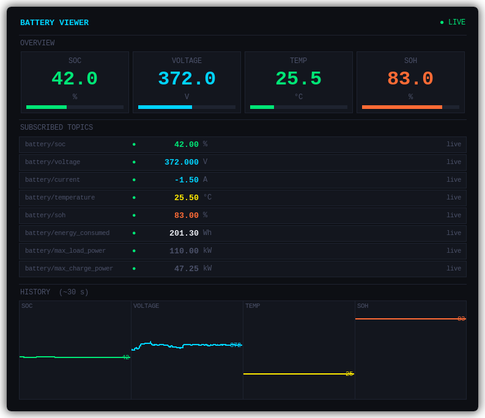

# Nissan LabVIEW ROS 2 Bridge

ROS 2 packages for integrating LabVIEW with the Nissan Leaf.

## Dependencies

- [ROS 2](https://docs.ros.org/en/humble/index.html) (tested with [](https://docs.ros.org/en/humble/) and [](https://docs.ros.org/en/jazzy/))
- A ROS 2 workspace with `colcon` installed

## Install and Build

Clone the repository into the `src` directory of a ROS 2 workspace:

```bash
cd ~/ros2_ws/src
```
```bash
git clone https://github.com/jkk-research/nissan_labview_ros2_bridge
```

Build all packages:

```bash
cd ~/ros2_ws
```
```bash
colcon build --packages-select nissan_bridge_msgs nissan_bridge nissan_bridge_gui nissan_speed_control --symlink-install --cmake-args -DCMAKE_BUILD_TYPE=Release
```

Source the workspace after building:

```bash
source ~/ros2_ws/install/setup.bash
```

## Packages

- `nissan_bridge_msgs`: ROS 2 message definitions for the bridge
- `nissan_bridge`: C++ bridge node
- `nissan_bridge_gui`: Python test GUI node
- `nissan_speed_control`: longitudinal PID control, `cmd_vel` → `control/accel_cmd`, `control/brake_cmd`


## Usage

Start the bridge in the `/nissan9` namespace with `nissan9/base_link` as `frame_id`:

```bash
ros2 launch nissan_bridge nissan_bridge.launch.py
```

The namespace and the frame can be overridden:

```bash
ros2 launch nissan_bridge nissan_bridge.launch.py namespace:=nissan9 frame_id:=nissan9/base_link
```

```bash
ros2 run nissan_bridge_gui battery_viewer --ros-args -r __ns:=/nissan9
```

Manual command publisher (sliders for `cmd_vel`, accel/brake, control state buttons, hold-to-buzz button) for the cRIO control cluster:

```bash
ros2 launch nissan_bridge_gui car_tester.launch.py
```

Slider ranges are parameters: `speed_limit` (0–10 m/s), `steer_limit` (±1 rad/s), `pedal_max` (1).

```bash
ros2 topic type /nissan9/battery/voltage
```

```
nissan_bridge_msgs/msg/Float64Stamped
```

```bash
ros2 topic pub -r 10 /nissan9/battery/temperature sensor_msgs/msg/Temperature "{header: auto, temperature: 48.82}"
```

## Published topics (`nissan_bridge_node`)

| Topic | Type | Unit | Source |
|---|---|---|---|
| `battery/soc` | `Float64Stamped` | % | EV 0x55B `LB_SOC` |
| `battery/voltage` | `Float64Stamped` | V | EV 0x1DB `LB_Total_Voltage` |
| `battery/current` | `Float64Stamped` | A | EV 0x1DB `LB_Current` |
| `battery/temperature` | `sensor_msgs/Temperature` | °C | CAR 0x5B3 `BatteryPackTemperature` or EV 0x5C0 `HistData_Temperature_AVG` (`battery_temperature_source`) |
| `battery/soh` | `Float64Stamped` | % | CAR 0x5B3 `BatteryStateOfHealth` |
| `battery/energy_consumed` | `Float64Stamped` | Wh | ∫V·I dt since node start (I × `battery_current_sign`, + = discharge) |
| `battery/max_load_power` | `Float64Stamped` | kW | EV 0x1DC `LB_Discharge_Power_Limit` |
| `battery/max_charge_power` | `Float64Stamped` | kW | EV 0x1DC `LB_Charge_Power_Limit` |
| `ev/powertrain/p_mech` | `Float64Stamped` | W | V·I × `battery_current_sign` (battery terminal power, + = discharge) |
| `vehicle_status` | `geometry_msgs/TwistStamped` | m/s, CAN units | `linear.x`: CAR 0x284 `VehicleSpeedFromABS`, `angular.z`: CAR 0x002 `SteeringAngle` |
| `vehicle/ambient_temperature` | `sensor_msgs/Temperature` | °C | CAR 0x510 `OutsideAmbientTemperature` |

The raw per-cluster topics (`ev/battery_power`, `ev/thermal`, `ev/battery_history`, `vehicle/state`) are still published.

## Subscribed topics → cRIO control cluster (ID 5, 100 Hz)

The node sends 8 big-endian floats to `crio_ip:crio_cmd_port` (defaults: `source_ip`, `63334`) at `control_rate_hz` (100):

| # | Field | Source topic | Type |
|---|---|---|---|
| 0 | ID = 5 | – | – |
| 1 | Timestamp (s since node start) | – | – |
| 2 | vehicle_speed_ref_cmd | `cmd_vel` `linear.x` | `geometry_msgs/Twist` |
| 3 | vehicle_steering_cmd | `cmd_vel` `angular.z` | `geometry_msgs/Twist` |
| 4 | accel_cmd | `control/accel_cmd` | `Float64Stamped` (0–1) |
| 5 | brake_cmd | `control/brake_cmd` | `Float64Stamped` (0–1) |
| 6 | control_state_cmd | `control/control_state_cmd` | `std_msgs/Int32` (1 Manual, 2 Autonomous_speed_ref, 3 Autonomous_pedal_ref, 4 Error, 5 Testing) |
| 7 | buzzer | `control/buzzer_cmd` | `std_msgs/Bool` (0.0 / 1.0) |

Last received values are sent; initial values are 0 and control state 1 (Manual). Out-of-range control states are ignored.

```bash
ros2 topic pub -r 50 /nissan9/cmd_vel geometry_msgs/msg/Twist "{linear: {x: 3.5}, angular: {z: -0.2}}"
ros2 topic pub -1 /nissan9/control/control_state_cmd std_msgs/msg/Int32 "{data: 2}"
```

## Speed control (`nissan_speed_control`)

```bash
ros2 launch nissan_speed_control speed_control.launch.py
```

| Direction | Topic | Type | Note |
|---|---|---|---|
| in | `cmd_vel` | `geometry_msgs/Twist` | `linear.x` reference, m/s (last value is kept; the `CMD_TIMEOUT` fallback to 0 is commented out in the source) |
| in | `vehicle_status` | `geometry_msgs/TwistStamped` | `linear.x` feedback from the bridge, m/s |
| in | `control_reinit` | `std_msgs/Bool` | `true` resets integrators and rate limiters |
| out | `control/accel_cmd` | `Float64Stamped` | 0–1 (`max_accel`) |
| out | `control/brake_cmd` | `Float64Stamped` | 0–1 (`max_brake`); `standstill_brake` (0.3) holds at standstill |
| out | `control_status` | `std_msgs/String` | `accel`, `brake`, `standstill5`, `standstill1` |

Ported from the Lexus `speed_control` node (same default gains, hysteresis, rate limits). Steering is not handled here: the bridge forwards `cmd_vel` `angular.z` to the cRIO directly. Link: [github.com/jkk-research/lexus_bringup/blob/main/src/speed_control.cpp](https://github.com/jkk-research/lexus_bringup/blob/main/src/speed_control.cpp)

# Image

